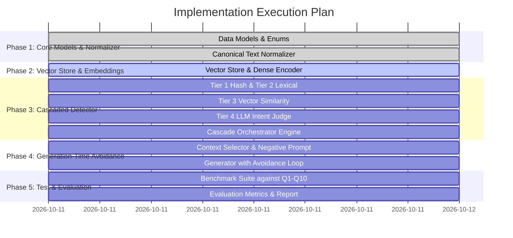

# Implementation Plan: AI Question Generation and Duplicate Prevention System

## Executive Summary
This document defines an end-to-end, production-grade implementation plan for the **AI Question Generation and Duplicate Prevention System** specified in [`question-2-duplicate-questions.md`](file:///c:/Users/karti/OneDrive/Desktop/intern/Induseuro_labs/question_2/question-2-duplicate-questions.md).

The solution solves two foundational challenges in AI-driven question banking:
1. **Generation-Time Avoidance**: Guiding LLMs to produce genuinely novel questions without exceeding context limits or duplicating existing questions in meaning or intent, scaling to tens of thousands of items.
2. **Independent Duplicate Detection**: A multi-tiered, cascading detection engine that catches exact duplicates, lexical rewrites, semantic paraphrases, and deep conceptual duplicates independently of the generator.

---

## 1. System Architecture & High-Level Design

### 1.1 Dual-Subsystem Architecture
The system decouples **Generation** from **Detection** to ensure zero shared-bias failure modes:

```mermaid
graph TD
    subgraph Question Corpus & Storage Layer
        DB[(Question Repository / DB)]
        VDB[(Vector Index / ANN Cosine Store)]
        ExactIndex[(Normalized MD5 Hash Index)]
    end

    subgraph Generation-Time Avoidance Engine
        UserPrompt[Generation Request: Topic, Grade, Bloom Level] --> ContextSelector[Hierarchical & Vector Context Selector]
        DB --> ContextSelector
        VDB --> ContextSelector
        ContextSelector --> PromptBuilder[Negative-Constrained Prompt Builder]
        PromptBuilder --> GenLLM[Question Generator LLM]
        GenLLM --> CandidateQ[Raw Candidate Question]
    end

    subgraph Independent Multi-Tier Duplicate Detector
        CandidateQ --> T1[Tier 1: O(1) Canonical Hash & Punctuation Normalizer]
        ExactIndex --> T1
        T1 -- Exact Match --> FlagExact[Flag: EXACT_DUPLICATE]
        T1 -- No Exact Match --> T2[Tier 2: Lexical & Jaccard Token Overlap Filter]
        
        T2 -- Jaccard >= 0.85 --> FlagLex[Flag: SEMANTIC_DUPLICATE (Lexical)]
        T2 -- Low/Medium Overlap --> T3[Tier 3: Dense Semantic Vector Cosine Match]
        VDB --> T3
        
        T3 -- Cosine >= 0.85 --> FlagSem[Flag: SEMANTIC_DUPLICATE]
        T3 -- Cosine < 0.65 --> FlagUnique[Flag: UNIQUE]
        T3 -- 0.65 <= Cosine < 0.85 --> T4[Tier 4: Deep LLM Concept & Intent Judge]
        
        T4 -- Assesses Same Concept/Answer --> FlagJudgeSem[Flag: SEMANTIC_DUPLICATE]
        T4 -- Ambiguous Edge Case --> FlagReview[Flag: AMBIGUOUS_REVIEW_NEEDED]
        T4 -- Distinct Knowledge Target --> FlagUnique
    end

    subgraph Feedback & Ingestion Loop
    FlagUnique --> Ingestion[Approved Question Ingestion]
    Ingestion --> DB
    Ingestion --> VDB
    Ingestion --> ExactIndex
    FlagExact --> RejectLoop[Regeneration / Rejection Feedback]
    FlagSem --> RejectLoop
    FlagJudgeSem --> RejectLoop
    RejectLoop -. Retry with Negative Exemplar .-> GenLLM
    end
```

---

## 2. Component Design & Technical Specifications

### 2.1 Subsystem A: Duplicate Avoidance During Generation

#### Challenge 1: Context Limits with Thousands of Existing Questions
* **Problem**: Passing hundreds or thousands of existing questions into the LLM context window exhausts token limits, increases inference costs, and causes "needle-in-a-haystack" attention degradation.
* **Solution**: **Two-Stage Context Retrieval & Negative Constraint Framing**:
  1. **Topic & Tag Filtering**: Filter candidate questions matching the target subject/concept tags (`topic: reflection_of_light`).
  2. **Maximal Marginal Relevance (MMR) / Semantic Clustering**: Retrieve representative exemplars of *what already exists* using dense embedding centroids rather than a flat dump.
  3. **Concept Coverage Map**: Provide high-level sub-topic anchors already tested (e.g., *"Already covered: Definition of reflection, Regular vs Diffuse reflection, Laws of reflection, Snell's law"*).
  4. **Dynamic Negative Exemplars**: Inject top-5 semantically closest questions as explicit `Do NOT generate questions testing or phrased like:` negative constraints.

#### Challenge 2: Avoiding Semantic Duplicates Across Wording Variations
* LLMs instructed with simple negative prompts ("don't repeat") frequently generate synonymous paraphrases (e.g., replacing *"What is..."* with *"Define..."*).
* **Mitigation**:
  - Direct the LLM to vary **Cognitive Depth (Bloom's Taxonomy)**: If existing questions are *Recall/Definition*, mandate *Application/Numerical* or *Analysis/Comparison*.
  - Require the LLM to output target learning objectives and expected answers alongside the question to force differentiation.

#### Challenge 3: Scalability as Corpus Grows
* **Index Partitioning**: Shard question embeddings by subject/domain hierarchy.
* **Sub-linear ANN Search**: Use HNSW (Hierarchical Navigable Small World) index for retrieval in $O(\log N)$ time.
* **Streaming Generation with Online Rejection**: Generate candidates in small batches (e.g., $k=3$), validate through the detection cascade, and conditionally accept or backtrack.

---

### 2.2 Subsystem B: Independent Duplicate Detection (Cascaded Multi-Tier Architecture)

To maximize throughput and accuracy while minimizing expensive LLM calls, detection runs in a **cascaded sieve**:

| Tier | Technique | Latency | Target Detection | False Positive / Negative Risk |
|---|---|---|---|---|
| **Tier 1** | **Canonical Text Normalization & MD5 Hash** | $<0.1$ ms | Exact duplicates, casing, punctuation, Unicode variations, whitespace differences (e.g. Q10 vs Q2) | Zero false positives. Misses rephrased queries. |
| **Tier 2** | **Lexical Token / Jaccard Overlap & Stemming** | $<1$ ms | High token overlap, word reordering, trivial conjunction edits | Fast rejection for near-identical wording. |
| **Tier 3** | **Dense Semantic Embeddings (Cosine Similarity)** | $5-15$ ms | Paraphrases and semantic equivalents (e.g. Q1, Q2, Q3, Q4) | Excellent general recall; can struggle with subtle polarity or nuance without threshold calibration. |
| **Tier 4** | **LLM Concept & Intent Judge (Cross-Encoder / LLM)** | $200-800$ ms | Boundary cases ($0.65 \le \text{sim} < 0.85$) and ambiguous scopes (e.g. Q8 vs Q1) | Extremely high precision on semantic equivalence, pedagogical intent, and answer equivalence. |

#### Mathematical Thresholds & Decision Boundaries
Given candidate vector $\vec{q}_{c}$ and corpus vectors $\vec{q}_{i} \in \mathcal{C}$:
$$\text{sim}(\vec{q}_{c}, \vec{q}_{i}) = \frac{\vec{q}_{c} \cdot \vec{q}_{i}}{\|\vec{q}_{c}\| \|\vec{q}_{i}\|}$$

- **$\text{sim} \ge 0.85$**: **`SEMANTIC_DUPLICATE`** (Instant match)
- **$\text{sim} < 0.65$**: **`UNIQUE`** (Safe to admit without LLM overhead)
- **$0.65 \le \text{sim} < 0.85$**: **Escalate to Tier 4 Judge** (Evaluates intent, required answer, and concept overlap)

---

### 2.3 Subsystem C: Tags and Dynamic Metadata

- **Schema Agnosticism**: Tags are stored as a flexible JSON key-value dictionary (`Dict[str, Any]`).
- **Isolation Principle**: Duplicate detection **never** relies on tag equivalence. Two questions with different tags (e.g., `grade: 8` vs `grade: 10`, or `difficulty: easy` vs `difficulty: medium`) that ask *"Define reflection of light"* are identified as duplicates based strictly on linguistic and conceptual content.
- **Filtering Utility**: Tags can be optionally supplied as pre-filters during generation to narrow retrieval scopes without contaminating detection logic.

---

## 3. Ground Truth Test Data Mapping & Expected Results

Testing against the test dataset from Section 6 of [`question-2-duplicate-questions.md`](file:///c:/Users/karti/OneDrive/Desktop/intern/Induseuro_labs/question_2/question-2-duplicate-questions.md):

| Test Pair / Candidate | Baseline Target | Expected Output | Cascaded Detection Tier | Rationale |
|---|---|---|---|---|
| **Q10 vs Q2** | "Define the reflection of light." | `EXACT_DUPLICATE` | **Tier 1 (Hash / Canonical)** | Exact string match after normalization |
| **Q2 vs Q1** | "Define the reflection of light." vs "What is reflection of light?" | `SEMANTIC_DUPLICATE` | **Tier 3 (Dense Vector)** | Same definition request; cosine similarity $> 0.85$ |
| **Q3 vs Q1** | "What do you understand by the reflection of light?" | `SEMANTIC_DUPLICATE` | **Tier 3 (Dense Vector)** | Common paraphrased exam prompt format |
| **Q4 vs Q1** | "Explain the meaning of light reflection." | `SEMANTIC_DUPLICATE` | **Tier 3 (Dense Vector)** | Inversion of noun phrase ("light reflection") |
| **Q5 vs Q1** | "State the laws of reflection of light." | `UNIQUE` | **Tier 3 (Score < 0.65) / Tier 4** | Inquires about the physical laws (i=r, plane), not definition |
| **Q6 vs Q1** | "What is the angle of reflection?" | `UNIQUE` | **Tier 3 / Tier 4** | Inquires about a specific geometric angle |
| **Q7 vs Q1** | "The angle of incidence is 30°. What is the angle of reflection?" | `UNIQUE` | **Tier 3 / Tier 4** | Numerical / computational problem |
| **Q8 vs Q1** | "What is reflection?" | `AMBIGUOUS_REVIEW_NEEDED` | **Tier 4 (Intent Judge)** | Broad concept (acoustic, mechanical, psychological, optical) vs specific optical topic |
| **Q9 vs Q1** | "What is the difference between regular and diffuse reflection?" | `UNIQUE` | **Tier 3 / Tier 4** | Comparative typology inquiry |

---

## 4. Step-by-Step Implementation Roadmap



### Step 1: Foundation Models & Enums (`models/` & `config.py`)
- **Deliverables**:
  - [`models/schema_types.py`](file:///c:/Users/karti/OneDrive/Desktop/intern/Induseuro_labs/question_2/models/schema_types.py): `DetectionTier`, `DuplicateStatus`, `QuestionType`.
  - [`models/question.py`](file:///c:/Users/karti/OneDrive/Desktop/intern/Induseuro_labs/question_2/models/question.py): `Question` entity with dynamic tags, auto-computed normalization, hash keys, and vector caching; `DetectionResult` entity.
  - [`config.py`](file:///c:/Users/karti/OneDrive/Desktop/intern/Induseuro_labs/question_2/config.py): Environment settings, similarity thresholds (`0.85`, `0.65`), multi-provider LLM credentials (Groq, Gemini, OpenAI, Mock).
- **Verification**: Run unit validation creating standard and tagged questions.

### Step 2: Canonical Normalization & Hashing (`utils/normalizer.py`)
- **Deliverables**:
  - [`utils/normalizer.py`](file:///c:/Users/karti/OneDrive/Desktop/intern/Induseuro_labs/question_2/utils/normalizer.py):
    - Unicode NFC normalization.
    - Contraction expansion (`what's` $\to$ `what is`).
    - Punctuation/symbols stripping.
    - Whitespace collapsing & lowercasing.
    - MD5 hash computation for $O(1)$ Tier 1 lookups.
    - Token set extraction & Jaccard similarity for Tier 2 lexical checks.
- **Verification**: Verify that `Q10` ("Define the reflection of light.") exactly matches normalized `Q2`.

### Step 3: Vector Store & Semantic Indexing (`storage/vector_store.py`)
- **Deliverables**:
  - Lightweight, high-performance in-memory Vector Store with support for cosine similarity and Annoy/FAISS vector indexing.
  - Semantic embedding pipeline utilizing `sentence-transformers` (`all-MiniLM-L6-v2`) with graceful fallback to API embeddings or deterministic mock vectors for offline development.
  - Metadata indexing by arbitrary tags to support pre-filtering without corrupting content-based duplicate checks.
- **Verification**: Index sample questions and verify nearest neighbor recall.

### Step 4: Multi-Tier Cascaded Duplicate Detector (`detector/`)
- **Deliverables**:
  - `detector/cascade.py`:
    - **Tier 1**: Hash table lookup against `hash_key` index.
    - **Tier 2**: Token Jaccard similarity against high-frequency terms.
    - **Tier 3**: Cosine similarity against Vector Store.
    - **Tier 4**: LLM-based Intent Judge for boundary/ambiguity resolution ($0.65 \le s < 0.85$). Evaluates:
      1. *Target Knowledge Element*
      2. *Required Answer Information*
      3. *Cognitive Depth / Task Equivalence*
- **Verification**: Run Q1–Q10 classification benchmark and verify 100% agreement with ground truth.

### Step 5: Generation-Time Avoidance Engine (`generator/`)
- **Deliverables**:
  - `generator/context_selector.py`: Context window manager that selects representative exemplars, clusters existing questions, and formats negative constraints.
  - `generator/engine.py`: LLM-driven generation loop:
    1. Prompts LLM with topic, desired cognitive level, and explicit negative exemplars.
    2. Receives candidate question.
    3. Pipes candidate through Independent Detector (as a verification gate).
    4. If detector flags a duplicate, feeds the duplicate reason back to LLM for regeneration (up to `MAX_GENERATION_RETRIES`).
    5. Returns approved novel question.
- **Verification**: Test generating 5 novel questions on "reflection of light" and confirm none duplicate Q1–Q10.

### Step 6: Comprehensive Benchmark & Evaluation Suite (`evaluator/`)
- **Deliverables**:
  - `evaluator/benchmark.py`: Runs automated evaluation against the Q1–Q10 corpus.
  - Metrics computation:
    - **Precision, Recall, F1-Score** for duplicate detection.
    - **Tier Activation Distribution** (percentage caught at Tier 1, 2, 3, 4).
    - **End-to-End Latency Profile** across tiers.
  - Interactive CLI/demo script (`run_demo.py`) showing:
    1. Exact duplicate detection (Q10 vs Q2).
    2. Semantic duplicate detection (Q2, Q3, Q4 vs Q1).
    3. Genuinely different questions (Q5, Q6, Q7, Q9 vs Q1).
    4. Ambiguous context review (Q8).
    5. Generation of brand-new, unique questions with duplicate avoidance.

---

## 5. Technology Stack & Key Decisions

| Component | Selected Technology | Rationale |
|---|---|---|
| **Language & Environment** | Python 3.12+ | Rich ecosystem for NLP, embeddings, ML, and FastAPI/Pydantic typing |
| **Embeddings** | `sentence-transformers` (`all-MiniLM-L6-v2`) | Compact (384 dimensions), fast local CPU inference (~10ms/batch), high semantic fidelity on sentence pairs |
| **Vector Index** | In-Memory / VectorStore with cosine similarity | Zero-dependency, lightweight, easily swappable with Qdrant/FAISS for $>100\text{k}$ scales |
| **LLM Orchestration** | LiteLLM / Direct Provider Client (Groq / Gemini / OpenAI) | Cost-effective, high speed, structured JSON outputs |
| **Validation & Schema** | Pydantic v2 | High-performance data validation, immutable models, automatic normalization hooks |

---

## 6. Evaluation Metrics & Performance Benchmarks

### 6.1 Accuracy Metrics
- **Precision**: $\frac{\text{True Duplicates Detected}}{\text{Total Flagged as Duplicates}}$ (ensures valid new questions are not mistakenly rejected).
- **Recall**: $\frac{\text{True Duplicates Detected}}{\text{Actual Duplicates in Corpus}}$ (ensures no duplicates slip past the detector).
- **F1 Score**: Harmonic mean of Precision and Recall.

### 6.2 Efficiency & Throughput Benchmarks
- **Tier 1 Latency**: $<0.05\text{ ms}$ (instant rejection of identical submissions).
- **Tier 2 Latency**: $<0.5\text{ ms}$.
- **Tier 3 Latency**: $<15\text{ ms}$ on standard CPU.
- **Tier 4 Latency**: $<600\text{ ms}$ (only invoked on $5\text{--}10\%$ borderline items).
- **Context Economy**: $>95\%$ reduction in LLM prompt token consumption compared to naive full-corpus injection.
